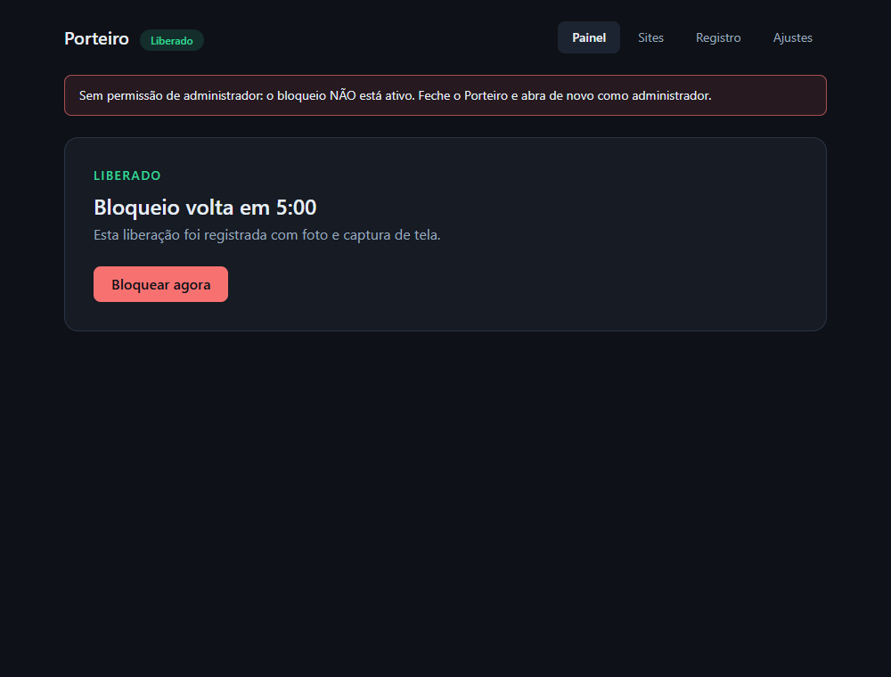

# Porteiro

Portão para Windows que bloqueia sites que distraem em todo o sistema até que a senha seja digitada, e registra cada desbloqueio. Feito com Tauri 2 (Rust) + React 19 + Tailwind v4.

```
senha certa ──► libera  ──► [hosts] [políticas] [firewall] saem, em ordem inversa
 senha errada ─► 📸 evento com foto + bloqueio progressivo
 a cada 5 s ──► confere as 4 camadas; se alguém desfez uma, ela volta e vira "Violação detectada" 📸
```

## Telas

| Painel bloqueado | Painel liberado |
|---|---|
|  |  |

Também há capturas do [primeiro uso](docs/primeiro-uso.png), da [lista de sites](docs/sites.png) e dos [alertas no Telegram](docs/telegram.png).

## Desenvolvimento

Requer Windows, [Bun](https://bun.sh) e o toolchain do Rust.

```bash
bun install
bun run tauri dev      # build de debug não exige administrador
bun run lint
bun run typecheck
bun test
cd src-tauri && cargo test --lib
```

O build de release exige administrador (manifest). Nunca rode `cargo test --release`.

Mais detalhes de arquitetura e regras que não podem regredir estão em [AGENTS.md](AGENTS.md); links de referência em [REFERENCES.md](REFERENCES.md).
