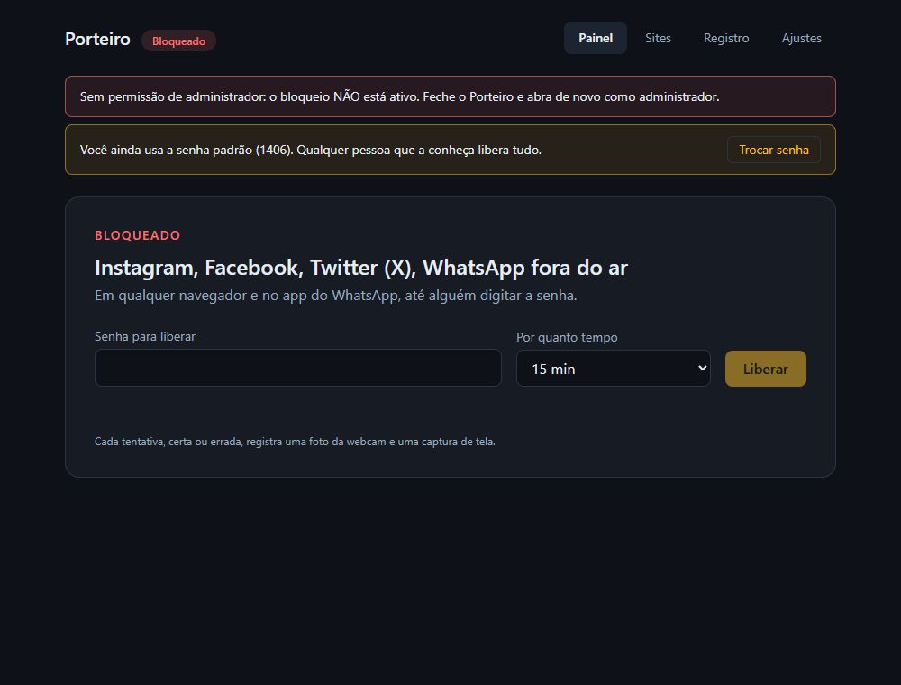
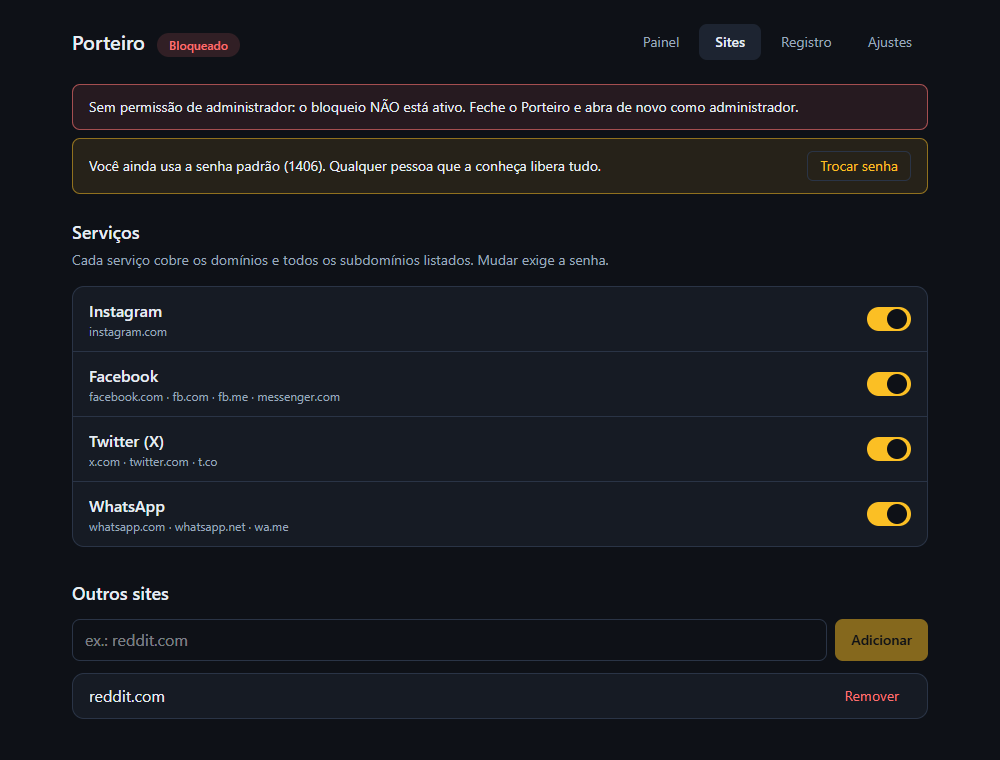
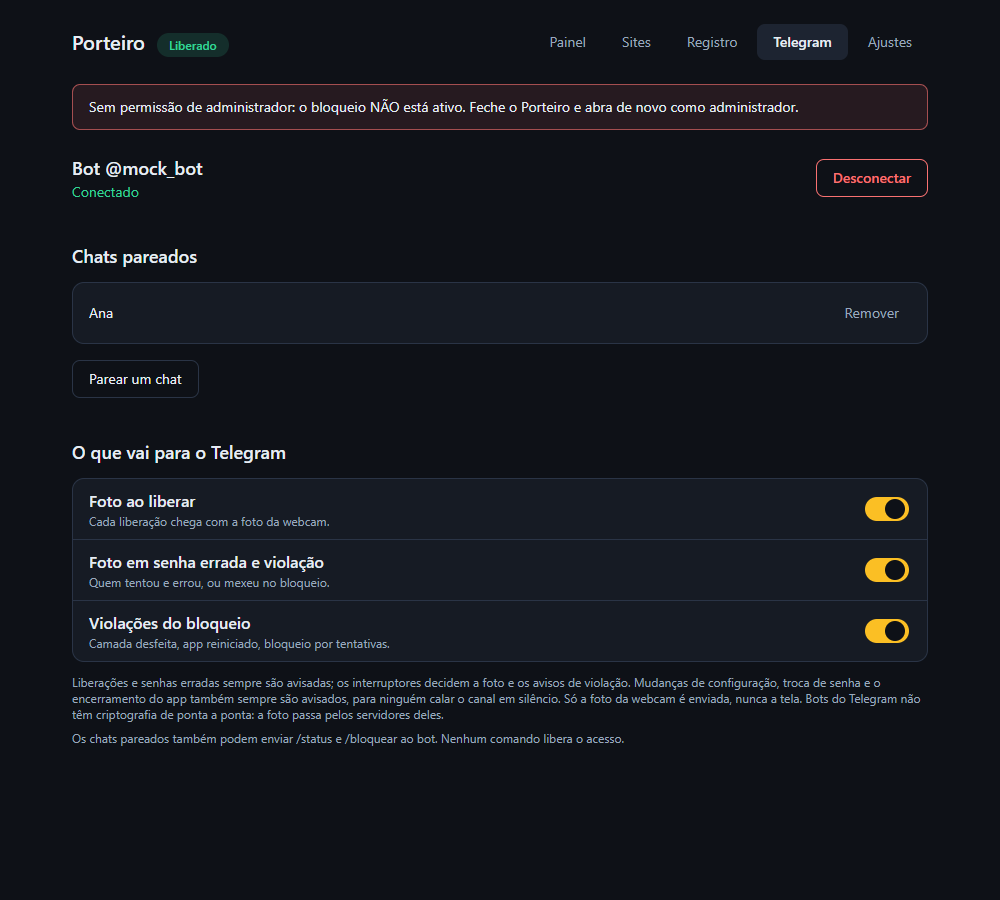

<div align="center">

# 🚪 Porteiro

**Bloqueia Instagram, Facebook, X e WhatsApp no seu PC até alguém digitar a senha,<br>e tira uma foto de quem tentou.**




<sub>Captura de um build de debug sem administrador, por isso o aviso vermelho. No release o bloqueio fica ativo.</sub>

</div>

---

## ✨ O que faz

- 🔒 **Bloqueado por padrão.** Instagram, Facebook, Twitter/X e WhatsApp saem do ar em qualquer navegador e no app do WhatsApp.
- 🔑 **Sem senha padrão.** No primeiro uso você escolhe a sua; até lá os sites já ficam bloqueados e nada libera.
- 🪪 **Windows Hello.** Opcional: rosto, digital ou PIN do Windows liberam no lugar de digitar a senha (Ajustes → Windows Hello).
- ⏱️ **Liberação com prazo.** De 1 a 240 min; o bloqueio volta sozinho. *Bloquear agora* não pede senha.
- 📸 **Monitoria.** Cada tentativa (certa ou errada), cada desbloqueio do Windows e cada tentativa de burlar vira um evento com **foto da webcam e print de cada monitor**.
- 📲 **Telegram (opcional).** Cada liberação, senha errada e violação chega no seu Telegram, ou no de outra pessoa que acompanhe, com a foto da webcam. A prova sai do PC: apagar o registro local não apaga o que já foi enviado.
- 🛡️ **Difícil de fechar.** O botão de fechar só esconde a janela; a única saída é *Desativar e sair*, com senha. Uma tarefa agendada reabre o app em até 1 min.
- 👀 **Sem esconder nada.** Tem janela, ícone na bandeja e tudo aparece no Registro. Não existe modo oculto.

<div align="center">


</div>

## 🧭 Uso

| Aba | Para quê |
|---|---|
| **Painel** | Digite a senha (ou use *Liberar com Windows Hello*), escolha a duração e clique em *Liberar*. |
| **Sites** | Liga e desliga os quatro serviços e adiciona domínios extras. `reddit.com` cobre também `www.reddit.com` e qualquer subdomínio. Toda mudança pede a senha. |
| **Registro** | Linha do tempo dos eventos, com as evidências (webcam primeiro, depois cada monitor). |
| **Telegram** | Conecta um bot, pareia chats e escolhe o que vai para o Telegram. Toda mudança pede a senha. |
| **Ajustes** | Trocar senha, ativar o Windows Hello, duração padrão, estado das camadas e *Desativar e sair*. |

## 📲 Telegram

Opcional e desligado por padrão. Serve para a evidência existir fora do computador e para uma segunda pessoa acompanhar.

1. No Telegram, abra o **@BotFather**, envie `/newbot` e copie o token.
2. No Porteiro, aba **Telegram**, cole o token e confirme com a senha.
3. Clique em **Parear um chat**: aparece um código de 6 dígitos (vale 5 min, uma vez só). Abra o bot, toque em *Iniciar* e envie o código. Repita com o celular de quem for acompanhar (até 3 chats).

<div align="center">

</div>

| Chega no Telegram | Observação |
|---|---|
| Liberação e senha errada | sempre; a **foto da webcam** vai junto se o interruptor estiver ligado |
| Violações (camada desfeita, app reiniciado, bloqueio por tentativas) | pode ser desligado |
| Mudança de configuração, troca de senha, encerramento do app, parear ou remover chat | **sempre**: ninguém cala o canal em silêncio |

Os chats pareados mandam `/status` (estado do bloqueio e das camadas) e `/bloquear` (reativa o bloqueio). **Não existe comando que libere.**

- O Porteiro só faz conexões de saída (long polling); não abre porta nem precisa de servidor.
- Só chats **privados** pareados são atendidos. Grupos e desconhecidos são ignorados; um desconhecido gera no máximo um evento por 10 min.
- O código de pareamento tem 5 tentativas erradas; depois a janela fecha.
- Sem internet, os alertas ficam numa fila (até 100, por até 6 h) e saem em ordem quando a conexão volta. A fila fica em `outbox.json` (sem o token), então alertas pendentes saem depois de um reinício; passadas 6 h, o alerta é descartado e o log de eventos continua com ele.
- Só a foto da webcam é enviada, **nunca a tela**. Bots do Telegram não têm criptografia de ponta a ponta: a foto passa pelos servidores deles.

## 🧱 Como o bloqueio funciona

```
 senha certa ──► libera  ──► [hosts] [políticas] [firewall] saem, em ordem inversa
 senha errada ─► 📸 evento com foto + bloqueio progressivo
 a cada 5 s ──► confere as 4 camadas; se alguém desfez uma, ela volta e vira "Violação detectada" 📸
```

| Camada | Cobre | Observação |
|---|---|---|
| `hosts` | qualquer app ou navegador que use o DNS do Windows | só nomes explícitos (o arquivo hosts não tem curinga) |
| Políticas dos navegadores | Chrome, Edge, Brave (`URLBlocklist`) e Firefox (`WebsiteFilter`) | curinga: domínio e todos os subdomínios; desliga DNS sobre HTTPS, que ignoraria o `hosts`. O Firefox só lê políticas ao iniciar |
| Firewall (IPs) | corta conexões **já abertas** (aba do Instagram, WhatsApp Web) | usa os IPs resolvidos antes de bloquear; CDNs podem usar outros |
| Processos | `WhatsApp.exe` e `WhatsApp.Root.exe` | encerrados enquanto bloqueado |

O estado vem do disco, então o bloqueio nunca "esquece" ao reiniciar: uma janela de liberação expirada não revive e um relógio movido para trás não estica a liberação.

## ⚠️ Limites (leia antes de confiar)

- **Você é administrador do próprio PC, então pode desfazer tudo** (desinstalar, apagar a tarefa, editar o hosts). O Porteiro torna isso um ato deliberado e registrado, não impossível. Para um bloqueio difícil de verdade: use o dia a dia numa conta **padrão** e deixe a senha de administrador com outra pessoa.
- Não cobre VPN, proxy, Tor, outro dispositivo, dados móveis nem espelhos dos sites.
- Navegadores sem política (Opera, Vivaldi…) ficam só com `hosts` e firewall.
- O Porteiro é dono das chaves de política que lista enquanto bloqueia: o que você já tinha ali é substituído e não é restaurado. Chrome, Edge e Brave passam a mostrar "gerenciado pela sua organização".
- O Telegram não substitui o cuidado com a conta: quem tiver o token do bot ou o celular pareado vê as fotos. Troque o token no @BotFather se suspeitar, e conecte de novo.
- Webcam ocupada (chamada de vídeo) ou sem permissão: o evento sai sem foto e o motivo aparece no detalhe.
- **Windows Hello inclui o PIN do Windows**: com ele ativado, quem souber o PIN da sua conta libera o bloqueio. Use um PIN que só você conheça, ou deixe o Hello desligado.
- Se o `config.json` for apagado ou corrompido, o app volta ao primeiro uso (sem senha): os sites continuam bloqueados, mas quem estiver no teclado pode definir uma nova senha. O evento fica registrado com foto.
- Senha de 4 dígitos é fraca contra quem tem acesso ao disco. Há bloqueio progressivo (5 erros → 30 s, dobrando até 1 h, mantido ao reiniciar), mas troque por algo maior.
- Um arquivo `hosts` que não seja UTF-8 não é reescrito; a camada aparece com erro no Painel.

## 🔐 Segurança e privacidade

- Senha guardada só como hash Argon2id; nunca em log. O Windows Hello é verificado pelo próprio Windows: o Porteiro só recebe "sim" ou "não", nunca o rosto, a digital nem o PIN.
- Dados (config, eventos, fotos e prints) em `C:\ProgramData\Porteiro`, restritos a SYSTEM e Administradores. Nada sai do computador, exceto o que você ligar no Telegram (texto e foto da webcam).
- O token do bot fica só em `telegram.json` (e na cópia `telegram.corrupt-*` que sobra se esse arquivo ficar ilegível), na mesma pasta protegida: nunca aparece na interface, no registro, em logs nem em mensagens de erro. Só `https://api.telegram.org` é contatado, e builds de release ignoram `PORTEIRO_TELEGRAM_API` para ninguém redirecionar o token.
- A interface não tem acesso a arquivos, rede nem shell. Toda ação privilegiada passa por comandos Rust que verificam a senha.
- Nomes de captura são validados (sem path traversal) e domínios aceitam só letras, números, pontos e hífens antes de ir ao `hosts`, ao registro ou ao `netsh`.
- Retenção: os 5000 eventos mais recentes; as capturas de eventos descartados são apagadas.
- 🚨 **Use somente no seu próprio computador.** Capturar webcam e tela de outras pessoas sem que saibam é ilegal em muitos lugares.

## 🛠️ Desenvolvimento

Requisitos: Rust estável, Bun, WebView2 e Build Tools do Visual Studio.

```powershell
bun install
bun run lint && bun run typecheck && bun test    # frontend
cd src-tauri; cargo test --lib                   # backend (149 testes; rode em debug)
bun tauri build                                  # release: exige administrador + instalador NSIS
```

Builds de debug **não** pedem administrador e mostram o aviso vermelho "bloqueio NÃO está ativo". Para rodar isolado, sem tocar no sistema real:

```powershell
$env:PORTEIRO_DATA_DIR = "$env:TEMP\porteiro-data"
$env:PORTEIRO_HOSTS_FILE = "$env:TEMP\porteiro-hosts"   # só a camada hosts, redirecionada
cd src-tauri; cargo run --features tauri/custom-protocol
```

Com essas variáveis o firewall, o registro e a tarefa agendada não são usados. Elas só valem em builds de debug: o release, que roda elevado, as ignora para que um processo comum não consiga apontá-lo para uma configuração nova, sem senha.

`PORTEIRO_TELEGRAM_API=http://127.0.0.1:PORTA` (também só em debug) aponta o bot para um Telegram falso local, o que permite testar o pareamento e os alertas sem rede.

Smoke do hardware (webcam e tela), gravando em pasta temporária ou em `PORTEIRO_SMOKE_DIR`:

```powershell
cd src-tauri; cargo test --lib smoke_capture -- --ignored --nocapture
```

Depois de instalar de verdade, confira as camadas com `scripts\verify-enforcement.ps1` (só leitura). O mapa do código e as regras que não podem regredir estão em [`AGENTS.md`](AGENTS.md).
